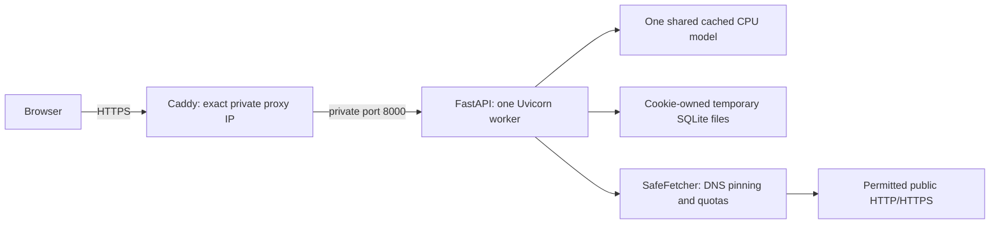

# Phase 4B — Bounded demo operations and local Docker verification

30 October 2026 (Australia/Sydney). Baseline `e08f8df`, including its stricter Phase 4A
homepage-route assertion (20 compatibility tests retained). Local commit subject:
**Bound demo admission storage and outbound operations with explicit proxy trust**.
No deployment, push, cloud operation, live website fetch, editorial task or model benchmark.

## Architecture and trust



The production template retains its password gate. Browser-owned workspaces, revision
checks, atomic imports, extraction, ranking and the shared-model/index design are reused.
Local source/Compose defaults retain the existing persistent demo. New application demo
admission/storage checks are opt-in (`DEMO_LIMITS_ENABLED`); production Compose enables them.

`Dockerfile` now disables Uvicorn forwarded-header rewriting and uses one worker,
32 concurrent connections/tasks, backlog 64 and five-second keep-alive. The app derives
identity from the immediate peer. It accepts `X-Demo-Client` only from explicitly trusted
**exact /32 or /128 peers**, rejecting invalid/duplicate identities. `X-Forwarded-For`,
`Forwarded` and untrusted custom headers do not supply rate-limit identity. Caddy overwrites
`X-Demo-Client` with its socket peer and `X-Demo-Scheme` with its request scheme. Only
the trusted peer may restore the scheme for API redirects; client IP rewriting remains
disabled at Uvicorn. Header-based trust requires running with that Docker command or an
equivalent `--no-proxy-headers` source launch, not an independently misconfigured ASGI proxy.

Production Compose uses a dedicated configurable IPv4 bridge, default
`172.30.42.0/29`: app `.2`, proxy `.3`; only proxy `.3/32` is trusted. The app has no
published port. Change subnet/app/proxy values together if they conflict with local
networks. Never broaden trust to all addresses. An upstream CDN/load balancer would
currently be counted as the peer; do not start trusting its client headers implicitly.
The local Docker verifier publishes only `127.0.0.1:8020`, with no trusted proxy configured.

## Implemented budgets

`semantic_analyser/demo_limits.py` uses locked, bounded rolling windows in one process.
Live buckets are not evicted to admit new identities. Full accounting state returns 503;
rate exhaustion returns 429 with Retry-After. API admission precedes body buffering and
workspace creation. All accepted/failed API attempts count. Health/static paths bypass
the app API counter, but the Docker server-level concurrency bound still applies.

| Setting | Default / production template | Meaning |
| --- | --- | --- |
| DEMO_HTTP_CONCURRENCY | 16 | Concurrent API middleware admissions; released on early errors too |
| DEMO_RATE_KEYS | 2048 | Maximum live accounting keys, including global buckets |
| DEMO_REQUESTS_PER_MINUTE | 240 | API requests per immediate/trusted client identity |
| DEMO_GLOBAL_REQUESTS_PER_MINUTE | 1200 | API requests across identities |
| DEMO_SESSIONS_PER_HOUR | 4 | New workspace attempts per client identity |
| DEMO_GLOBAL_SESSIONS_PER_HOUR | 32 | New workspace attempts across identities |
| DEMO_OUTBOUND_PER_HOUR | 120 | Wire-attempt admissions per workspace owner across fetch runs |
| DEMO_GLOBAL_OUTBOUND_PER_HOUR | 600 | Wire-attempt admissions across all owners |
| MAX_VISITOR_WORKSPACES | source 32 / production 16 | Existing persisted workspace capacity |
| MAX_CACHED_INDEXES | source 4 / production 2 | Existing inactive-index eviction bound |

Outbound accounting executes before each DNS/transport attempt, including robots,
redirects and failed destinations. New run objects do not reset owner/global accounting.
The earlier per-run 60 attempts, bytes, active/absolute deadlines, per-site pacing and
bounded executor remain. Login accounting now expires old entries rather than clearing
all live counters at its address cap. There is no new distributed store/service.

Limits count identities, not authenticated people. Shared NATs can reach the conservative
four-session limit; IPv6 address rotation can evade an individual-IP limit but not global
capacity. Tune for the intended limited audience. Rate windows reset on process restart
and are not crash-durable; workspace ownership/data persist with a stable signing key.
These controls are not DDoS protection, durable billing quotas or multi-worker fairness.

## Storage and retention

With demo limits enabled, visitor Stores set SQLite `max_page_count` on **every connection**
using `WORKSPACE_STORAGE_BYTES` (16 MiB default). This caps growth of the main database;
SQLite full errors return a safe 507 and transactions roll back. An already larger
existing database is not truncated: SQLite cannot lower its limit below existing pages.

Creation and mutating-operation guards scan actual SQLite/WAL/SHM files without following
symlinks. They reject admission at the per-workspace physical threshold or aggregate
`VISITOR_STORAGE_BYTES` (128 MiB), and below `STORAGE_MIN_FREE_BYTES` (128 MiB free).
Unknown contents require operator attention, not automatic deletion. Reads, CSV export
and explicit owned deletion remain available when this admission threshold is reached.
Actual filesystem failure/full disk can still prevent SQLite lease metadata updates;
that requires operator recovery rather than a guarantee that exports will succeed.
Failed new database creation removes only the newly server-chosen directory's known
regular SQLite files. It never recursively deletes arbitrary paths.

Physical totals are **soft admission thresholds**, not filesystem quotas: uncommitted
transactions/WAL/checkpointing, concurrent metadata touches and one in-flight write can
overshoot. The main SQLite page limit is harder, but does not cap WAL or all host storage.
Use host/volume quota and disk monitoring for a public runtime. The quota guard deliberately
does not acquire the manager lock inside a SQLite transaction; doing so caused a lock
inversion found by the concurrent-edit regression and fixed before final verification.

Existing configurable idle expiry (1h), absolute expiry (24h) and 60-second sweep remain,
now explicit in production Compose. Active-job leases defer cleanup; timeouts never
free an executor slot/lease while work continues. Export/deletion/restart ownership and
late-write rollback remain tested. Retention is not immediate secure erasure: blocked
cleanup, backups, process downtime and developer caches require separate operator policy.
Do not back up temporary visitor content without a disclosed retention decision.

## Outbound restrictions

The supported application path allows only public HTTP:80 / HTTPS:443, validates every
DNS answer, pins numeric peers, verifies TLS, denies private/link-local/metadata networks,
and revalidates same-host redirects/robots. These controls remain unchanged and regression
tested. `FETCH_DENY_CIDRS` adds operator-owned public/infrastructure destinations.
New optional `FETCH_ALLOWED_HOSTS` is an exact normalised hostname list (comma separated).
An empty list preserves public-site imports; a nonempty list rejects other hosts before
DNS. It grants **no** exception to SSRF/address validation. DNS resolving an allowed
hostname to private or mixed public/private addresses still fails closed.

No kernel/firewall rule was applied or verified here. The Compose bridge itself is **not
an egress firewall**, and existing AWS Terraform still permits all IPv4 egress. A deployment
must enforce an operator-tested network policy: allow established response traffic and
the configured DNS resolver's TCP/UDP 53; allow permitted public TCP 80/443; deny other
ports and private/link-local/metadata IPv4/IPv6 destinations, including operator public
infrastructure ranges. Handle Docker's resolver/private proxy path explicitly rather than
blindly blocking all private traffic. A compromised process can bypass application
SafeFetcher; exact-host filtering is not equivalent to a network-layer firewall.

## Container settings and commands

The image still pre-caches the pinned CPU model at build time and uses offline model
flags at runtime. No image was built or model loaded in Phase 4B. Production app settings:
read-only image filesystem, writable private workspace volume, 64 MiB `/tmp` tmpfs,
4 GiB memory/no additional swap, 2 CPU quota, PID limit 128, dropped capabilities and
no-new-privileges. Proxy has 256 MiB/0.5 CPU/PID 128. These are configurable containment
defaults, **not measured capacity guarantees**. Global disk space and named-volume growth
are not hard-limited by those settings. Existing rotating logs/restart policy remain.

The existing image health check polls `/health`. The endpoint now checks preloaded-model
readiness when required and visitor-manager lock/cleanup-thread readiness. Budget-full
storage is a recoverable admission condition, not an automatic restart trigger. Docker
unhealthy status alone does not imply Docker restarts a running process.

No Docker CLI was found in PATH or the standard Docker Desktop location. Actual Linux
container, Caddy syntax/runtime/HTTPS, model-cache startup, Linux symlink and kernel quota
verification are **not passed**. Static YAML parsing/address/command checks are separate.

For a future local verification with Docker installed and an **already-built current
Linux image**, no public model/site requests are needed:

```powershell
$env:LOCAL_IMAGE = 'semantic-demo:local'
docker info --format '{{.OSType}}'
docker image inspect $env:LOCAL_IMAGE
docker compose -f deploy/local/compose.verify.yaml config --quiet
.\.venv\Scripts\python.exe -B scripts/verify_phase4b_docker.py --image $env:LOCAL_IMAGE
```

`config` validates Compose without starting services. The Python helper uses a uniquely
named disposable Compose project, `up -d --wait`, and `down --volumes` only for that project.
It never builds/pulls an image, uses loopback port 8020, disables website fetching/model
preload, checks current application-source hashes, cookie-owned review separation,
restart persistence, health and configured cgroup values. It does not test actual cgroup
exhaustion, proxy HTTPS, real model startup or a firewall. Missing Docker records
`status=skipped`, `linux_container_verified=false` (exit 0 is not a pass claim). Missing
daemon/image or failed checks record blocked/failed. See runtime/phase4b/docker-verification.json.
Do not use this local configuration/embedded disposable key publicly.

## Actual evidence and next milestone

Relevant tests: new demo operations plus application, website, SafeFetcher/API, visitor
workspaces and collection admission. **271 passed, one skipped, 31.79 seconds** (pytest).
After test-only strengthening of scheme/readiness checks, the final operations file
passed all **22 tests in 1.53 seconds**; application code was unchanged after the
broader regression run. These are overlapping targeted runs, not additive test counts.
Skip: existing Windows symlink cleanup test requires symlink privileges; Linux follow-up
remains. Tests use deterministic fake encoders and controlled network fixtures, not
real MiniLM or public sites. Full historical/evaluation suite and benchmarks were not run.
An initial regression run found the lock inversion described above; the corrected
focused concurrency test and final relevant selection passed. Portable evidence:
`docs/phase4b-verification.json`. Existing data, ranking/security-policy files outside
the documented hooks and historical artifacts were checked for preservation.

Recommended **Phase 4C: verified local Linux release rehearsal**. Obtain Docker/current
image without exposing services publicly, verify HTTPS/header replacement, current-source
visitor smoke, actual CPU/memory/PID/storage exhaustion, cleanup/restart/shutdown, and a
kernel egress policy against controlled fixtures. Review dependencies/image patch status,
define monitoring/retention and assess process-restart abuse. Only then consider a separately
authorised limited deployment. Docker availability, firewall proof and capacity evidence
remain blockers; no new editorial/model evaluation is requested.
