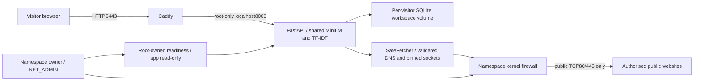

# AWS deployment recommendation — planning only

2 November 2026, Australia/Sydney. No account resources, alerts, domains or services
were created. This is a conditional plan, not deployment approval or a quotation.
Image findings and measured local checks: `phase4e-security-review.md`.

## Hosting comparison and cost assumptions

All figures are **USD/month**, before tax/domain registration, without free credits,
Savings Plans, exchange-rate assumptions or automatic scaling. Assume a small gated
portfolio demo, one Linux/x86_64 host, one app process/shared CPU MiniLM, one namespace
owner and Caddy; low traffic within the transfer allowance. Eight GB is a starting
host size, not a measured public concurrency guarantee. The current4GiB app ceiling
plus proxy/owner/OS makes a4GB host an unsuitable default without further capacity work.

| Option | Monthly estimate | Fit for this repository |
| --- | --- | --- |
| **Lightsail Linux VM,8GB/2vCPU, Sydney** | **$44 bundle; plan around$50 total** | Lowest predictable cost; rootful Docker permits testing our exact namespace firewall. Includes160GB disk and publicIPv4. Sydney receives half the displayed5TB transfer allowance. No autoscaling. Burstable CPU requires pacing/capacity checks |
| **EC2 t3.large, Sydney** | **$77.09 compute; about$95 total, budget$100** | Better IAM instance-role/SSM/CloudWatch integration and richer AWS learning; same one-host Compose architecture. EBS/IPv4/logs separately billed; use Standard CPU credits to avoid Unlimited surplus charges |
| Lightsail managed container service,8GB | **$160/node before extras** | More expensive; not a substitute for a VM. No demonstrated ability to run this exact privileged-owner/Compose/storage policy. Not recommended without an independent supported egress design |
| ECS Fargate | Not quoted as a viable equivalent | AWS explicitly restricts NET_ADMIN. Our enforcement owner cannot be transplanted unchanged; load-balancing/network/storage changes add cost and architecture work. No claim that an AWS security group replaces our deny policy |
| App Runner | Excluded | AWS stopped accepting new customers30April2026; existing services are in maintenance. Not a new-customer deployment path for this project |

Sources: [Lightsail pricing and regional allowances](https://aws.amazon.com/lightsail/pricing/),
[Lightsail CPU baselines](https://docs.aws.amazon.com/lightsail/latest/userguide/baseline-cpu-performance.html),
[EC2 pricing](https://aws.amazon.com/ec2/pricing/on-demand/),
[Fargate capability restrictions](https://docs.aws.amazon.com/AmazonECS/latest/developerguide/fargate-security-considerations.html),
[App Runner notice](https://aws.amazon.com/apprunner/).

EC2 compute is independently checked against the public AWS regional pricing feed:
`t3.large`, Linux,2vCPU/8GiB, Sydney, rate code
`B7WDU84CV8BAGNYW.JRTCKXETXF.6YS6EN2CT7`, **$0.1056/hour x730=$77.088**.
The response and source URL are recorded in `runtime/phase4e/aws-ec2-sydney.json`
and the portable verification JSON. Unlike compute, the allowances below are planning
reserves rather than verified regional line-item quotes:

* EC2: compute77.09 + publicIPv4(0.005x730=3.65) +40GB EBS reserve5 + selective
  recovery-storage reserve2 + logging/monitoring reserve4 + private-registry reserve1
  + optional DNS0.50 + transfer reserve2 = **95.24**.
* Lightsail: fixed44 + private-registry reserve0.50 + optional DNS0.50 + selective
  recovery reserve1 + operational/usage reserve4 = **50**.

[IPv4 rate](https://aws.amazon.com/vpc/pricing/), [EBS pricing](https://aws.amazon.com/ebs/pricing/).
Obtain a saved AWS Calculator quote before approval. Storage/traffic/log use, retained
images, extra hosts, unused IPs and snapshots can raise the bill; estimates are not
hard caps. Lightsail snapshots cost$0.05/GB-month but are deliberately not part of
the default visitor-data recovery design below. No NAT gateway, ALB, RDS, Redis,
managed firewall or autoscaling group is proposed for this small demo.

## Recommended starting architecture

**Choose the Lightsail8GB Linux VM for the stated low-cost portfolio objective**,
subject to security/capacity acceptance. Choose the EC2 alternative if IAM roles,
SSM-based administration and native custom monitoring justify approximately$45/month
more. The existing Terraform is EC2-specific; it is not applied or silently converted.

Use an x86_64 Linux blueprint and rootful Docker/Compose. Build release images on a
separate adequately sized builder; never compile Go or download training/build caches
on the small public host. Use private ECR with immutable app/owner/proxy digests and
restricted pull permissions. No source tree, developer database, review packets or
runtime evidence is copied to the host as application data. Built-in samples remain
synthetic; start visitors in independent temporary collections.

The three services share the **controlled network namespace**, not a shared
filesystem. App has no capabilities; owner alone has NET_ADMIN; proxy has only bind
capability. Only frontend ports are published. Retain the password gate, visitor
cookies, admission/rollback, revisions, robots/time/byte/request budgets and one
bounded analysis worker. No horizontal scaling: accounting, locks and SQLite are
designed for this single-process demo.

HTTP80 is for ACME/redirect; HTTPS443 is the application. Caddy manages public
certificates only after authorised DNS points to the intended host and ACME is
verified. No direct backend8000 or admin2019 exposure. SSH, if needed on Lightsail,
is key-only and restricted to an administrator address; do not expose Docker's API.
Do not introduce a CDN/proxy until forwarding identity and budget behaviour are retested.

## Secrets and administration

Generate signing secret/password on the intended host or inject them securely through
the operator. Store deployment environment files outside Git, web/ and image contexts,
root-readable only; Compose environment values remain visible to the Docker operator.
Never embed AWS keys in browser assets or app images. Maintain MFA/least privilege
for the operator and restrict ECR pulls: backend source is readable to image holders.

Lightsail does **not** provide the EC2 instance-profile role workflow. Do not assume
that SSM/Secrets Manager/ECR/CloudWatch agents can automatically get short-lived
credentials there. The simple Lightsail plan uses operator-managed host secrets and
operator-obtained short-lived registry login for releases, with no long-lived AWS
access key on the host. Deployment login credentials should be removed after pulls.
Custom automated AWS agents/backups require a separate credential design, not a
quietly added IAM-user key. [AWS's Lightsail deployment guidance](https://aws.amazon.com/blogs/compute/using-aws-codedeploy-and-aws-codepipeline-to-deploy-applications-to-amazon-lightsail/)
explains the lack of assignable instance roles.

The EC2 alternative uses a narrowly scoped instance role for ECR read, selected
SecureString parameters and monitoring/SSM. No AWS credentials are passed to the app.
Require IMDSv2, test a hop limit appropriate for host-only agents, and explicitly
deny both metadata address families from containers. Review Terraform's role scope,
metadata settings and its **t3.medium4GB default** before use; select8GiB explicitly.
The existing helper also needs all three reviewed image references and an intended-host
review; no claim is made that its old deployment path is release-ready.

## Outbound enforcement must be proven on the selected host

Lightsail's console firewall controls public inbound traffic and **allows outbound
traffic**. EC2 security groups are allow rules, not a way to express 'all public
destinations except private/metadata'. Terraform currently allows broad egress and
has not been hardened or applied. Neither replaces our kernel/SafeFetcher layers.
[Lightsail firewall scope](https://docs.aws.amazon.com/lightsail/latest/userguide/understanding-firewall-and-port-mappings-in-amazon-lightsail.html).

Before public binding, repeat the controlled localhost Linux rehearsal on the exact
host/kernel/Docker release. Verify both filter families, embedded DNS UDP/TCP, IPv6
neighbour discovery, private/metadata/direct-socket denial, public-classified local
HTTPS peers, failure without NET_ADMIN, stale-owner503, drift quarantine and dependent
namespace recreation. Verify actual VPC/host routes and add host-specific global
control-plane IP denies where necessary. The Docker daemon, host, DNS forwarder,
owner and root proxy remain trusted. Do not enable host networking or add Docker
socket mounts as a workaround for failed readiness.

Choose Docker subnets that do not overlap the host/VPC. Apply proxy configuration
through a controlled restart/recreation; do not open the protected admin port to make
hot reload work. The lab adds a localhost TLS health check; the intended production
monitor must verify the real public HTTPS path separately.

The owner should start fail-closed when enforcement is unavailable. Confirm that
reboot and owner recreation do not leave dependants on an obsolete namespace. A
controlled outbound policy compatible with imports is **locally demonstrated**, not
automatically certified on Lightsail, EC2 or any managed service.

## Retention, monitoring and recovery

Retain current defaults: idle1h, absolute24h, cleanup sweep60s; defer physical deletion
while a job holds its lease. Explain expiry versus actual deletion and that SQLite
deletion is not secure erasure. Do not copy the local development collection into
the public workspace or promise durable article storage.

Set a tested host filesystem/project quota for the workspace area, with headroom for
WAL/SHM and SQLite rollback. Current16MiB page/128MiB aggregate checks alone are not
hard disk quotas. Keep app4GiB, owner96MiB and proxy256MiB caps; host overhead and
burstable CPU/load still need validation. Build caches stay off the host. Rotate logs,
set short explicit log retention and restrict operator access to possible query strings.

Use Lightsail's native status/CPU/burst/network metrics and alarms where supported.
They do not automatically provide guest disk/memory telemetry. Require an operator
or independently monitored guest check for free disk, quota exhaustion, cleanup
failures and unhealthy services; choose that monitoring/credential path before launch.
For EC2, least-privilege CloudWatch/SSM agents can provide this through its instance
role. Add alerts for repeated503/507, owner quarantine, restarts and loss of health;
alerts are not proof that automatic recovery is safe.

**Do not take unqualified whole-host snapshots containing visitor workspaces** while
promising short retention. A snapshot preserves deleted SQLite bytes beyond that
promise. Prefer reconstructing the host from reviewed images/configuration and
selective encrypted recovery material, excluding visitor data/logs. Temporary visitor
collections may be lost on host recovery; make CSV export and that limitation clear.
Reissue TLS certificates/rotate signing keys if recovery material is unavailable;
test the recovery/certificate rate-limit implications. If visitor backups are later
required, obtain a separate retention/access design and notice rather than adding
them silently. Recovery tests must not restore one visitor's data into another workspace.

Plan billing alerts at50%,80%,100% of an agreed monthly budget plus forecast/anomaly
notifications, region/resource restrictions and an explicit manual shutdown playbook.
[AWS Budgets can notify after usage has exceeded a threshold](https://docs.aws.amazon.com/cost-management/latest/userguide/budgets-managing-costs.html);
it is not a guaranteed real-time spending ceiling. No alerts have been configured here.

## Approval gates — stop before another infrastructure phase

1. Resolve or formally disposition remaining OS/proxy advisories, including unfixed
   Go JOSEv3 and disputed zlib; preserve findings, don't hide them with ignores.
2. Complete the fresh full new-app image index and release provenance on a sufficiently
   sized builder; record digests, inventories, source/secret checks and license notices.
   The complete Caddy Dockerfile build passed with trusted cache and identical runtime
   files/configuration to the tested image; a cache-free replay was not attempted.
3. Agree the monthly USD budget, provider/region/architecture, administration/secrets,
   guest-disk monitoring, quota and no-visitor-backup recovery approach.
4. Authorise intended-host provisioning/testing separately. Run controlled kernel,
   isolation, TLS/proxy, expiry, overload/storage and restart/recovery acceptance there.
   Capacity evidence must cover realistic concurrent use; no new accuracy claim is needed.
5. Only then authorise DNS/ACME/public access. Keep the demo gate and experimental
   recommendation wording; further editorial evaluation is intentionally deferred.

Phase4E stops at this recommendation. No resources, Terraform changes, cloud secrets,
billing alarms, public DNS, deployment or GitHub push were performed.
